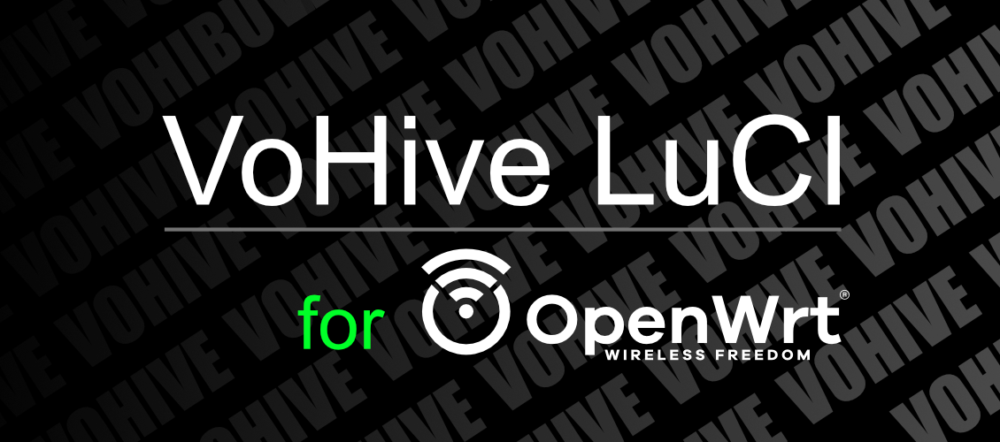

<p align="center">
  
</p>

<h1 align="center">luci-app-vohive</h1>

<p align="center">
  <strong>OpenWrt / ImmortalWrt LuCI app for VoHive</strong><br />
  Core install, service control and config management from the router web UI
</p>

<p align="center">
  <a href="LICENSE"></a>
  <a href="https://openwrt.org/"></a>
  <a href="https://github.com/openwrt/luci"></a>
  
  
  <a href="https://github.com/voorz/luci-app-vohive/releases"></a>
</p>

<p align="center">
  <sub>Original author / developer: <a href="https://github.com/Demogorgon314"><strong>@Demogorgon314</strong></a></sub>
</p>

<p align="center">
  <a href="#overview">Overview</a> ·
  <a href="#features">Features</a> ·
</p>

---

## Overview

```text
LuCI → Services → VoHive
```

---

## Features

| Module                 | Description                                                                        |
| ---------------------- | ---------------------------------------------------------------------------------- |
| **Core management**    | List GitHub Release versions; install / update / roll back the VoHive core         |
| **Task progress**      | Show download progress, downloaded / total size and speed                          |
| **Service control**    | Start, stop, restart the procd-based VoHive service                                |
| **Config management**  | Edit via UCI, rendered to `/etc/vohive/config/config.yaml`                         |
| **Status & logs**      | Core version, arch, service state, port listening and recent logs                  |
| **Plugin self-update** | Supports OpenWrt 24 (`opkg` / `.ipk`) and 25 (`apk` / `.apk`)                      |

Roll-back keeps only the previous version and arch metadata; the old core is re-downloaded on roll-back, so **a second full binary is never stored permanently in flash**.

---

## Related Links

- [This plugin's Releases](https://github.com/voorz/luci-app-vohive/releases)
- [OpenWrt docs](https://openwrt.org/docs/start)
- [LuCI project](https://github.com/openwrt/luci)

---

## License

The LuCI plugin source in this repo is released under **MIT** (see `PKG_LICENSE` inside the package).

---

<p align="center">
  <sub>VoHive Dashboard for LuCI-App · Built for OpenWrt</sub>
</p>
